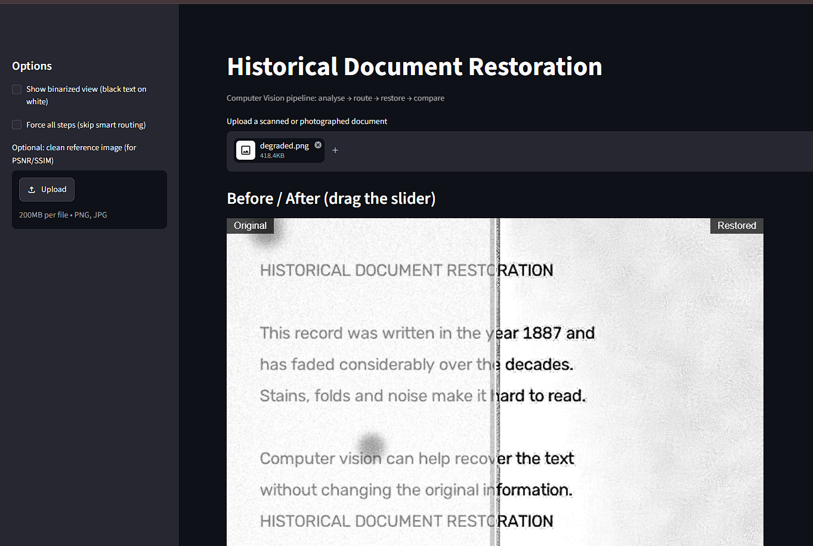
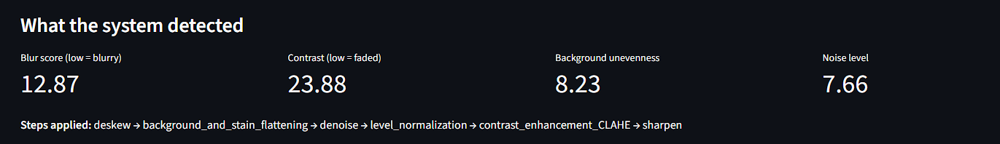
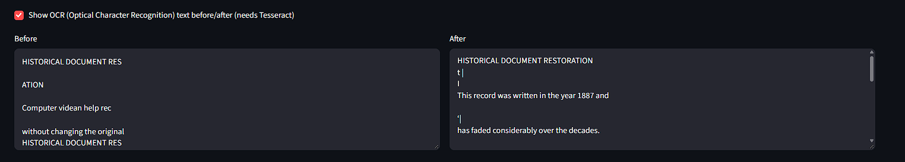

Readme · MD
# Historical Document Restoration
 
A Computer Vision (CV) project that restores faded, stained, noisy and unevenly lit images of historical documents. The system first measures what is wrong with a page, then runs only the restoration steps that page needs, and shows the original and the restored page side by side.
 
**Team:** Shruti Wadnerkar (core pipeline), Archita Jain (data and evaluation), Swapnil Patil (app, OCR and report)
 
## What it does
 
1. Upload a scan or photo of a damaged document.
2. The system measures noise, blur, contrast and background unevenness.
3. It applies the matching restoration steps (smart routing).
4. You compare the original and restored page, see the detected scores and the steps applied, and download the result.
## Pipeline
 
```
grayscale -> analysis -> deskew -> background and stain flattening
          -> denoise (if noisy) -> level normalization
          -> CLAHE (if faded) -> sharpen (if blurry) -> optional binarization
```
 
| Stage | What it does | When it runs |
|---|---|---|
| Analysis | Measures noise, blur, contrast, background unevenness | Always |
| Deskew | Straightens tilted pages (projection-profile search, up to 5 degrees) | Only if a clear tilt of 0.5 degrees or more is found |
| Background and stain flattening | Divides out the paper layer (yellowing, shadows, stains, fold shading) | Always |
| Denoise | Non-local means; strength is 1.6 times the measured noise, capped at 20 | If the page is noisy |
| Level normalization | Makes ink black and paper white | Always |
| CLAHE | Contrast Limited Adaptive Histogram Equalization (clip limit 1.0) | If the page is faded |
| Sharpen | Unsharp mask | If the page is blurry |
| Binarization | Sauvola thresholding, black text on white page | Optional output |

## Screenshots



 
## Setup (Windows PowerShell)
 
```powershell
git clone https://github.com/shruti1804/doc-restoration
cd doc-restoration
python -m venv .venv
.venv\Scripts\Activate.ps1
pip install -r requirements.txt
```
 
If PowerShell blocks the activation script, run `Set-ExecutionPolicy -Scope CurrentUser RemoteSigned` once and activate again.
 
Optional, for OCR (Optical Character Recognition) text comparison and CER (Character Error Rate):
 
```powershell
winget install --id UB-Mannheim.TesseractOCR -e
$env:Path += ";C:\Program Files\Tesseract-OCR"
```
 
## Run
 
```powershell
python degrade.py              # creates sample clean and damaged pages in samples\
streamlit run app.py           # web app
python evaluate.py             # results on synthetic pages -> outputs\results.csv, ablation.png
python evaluate.py --steps     # contribution of each step -> outputs\step_by_step.csv
python evaluate.py --real      # results on real images in data\real -> outputs\real_results.csv
python try_real.py             # before/after images for data\real -> outputs\
```
 
Put your own scans in `data\real\`. That folder and `outputs\` are not tracked by Git.
 
## Results (synthetic test pages)
 
PSNR (Peak Signal-to-Noise Ratio) and SSIM (Structural Similarity Index Measure): higher means closer to the clean page.
 
| Damage level | PSNR before (dB) | PSNR after (dB) | SSIM before | SSIM after |
|---|---|---|---|---|
| Light | 19.96 | 25.17 | 0.745 | 0.914 |
| Medium | 14.40 | 18.20 | 0.338 | 0.665 |
| Heavy | 10.13 | 13.52 | 0.101 | 0.272 |
 
- Denoising is the strongest step (SSIM +0.17 light, +0.38 medium, +0.32 heavy).
- Background flattening adds 2.3 to 2.6 dB PSNR at every level.
- CLAHE lowers SSIM by about 0.02 but makes faded ink easier for a person to read.
Real scans have no clean reference, so they were judged visually.
 
## Project structure
 
```
doc-restoration/
|-- restore/
|   |-- analyze.py     degradation measurements
|   |-- steps.py       each restoration step
|   |-- pipeline.py    smart routing (analysis decides the steps)
|   `-- metrics.py     PSNR, SSIM, OCR, CER
|-- degrade.py         synthetic damage generator (light, medium, heavy)
|-- evaluate.py        evaluation modes and ablation
|-- try_real.py        run the pipeline on real images
|-- app.py             Streamlit web app
|-- samples/           generated sample pages
`-- requirements.txt
```
 
## Known limitations
 
- Quality on real scans is judged visually, on a small set of images.
- Heavy damage is only partly restored (SSIM about 0.27 on heavy test pages).
- A faint line can remain where a fold crosses the page; there is no dewarping, tear repair or bleed-through removal.
- Thresholds (noise, contrast, blur) are calibrated on a small sample and may need retuning for very different documents.
- The output is grayscale, so ink colour is lost.
## Future work
 
- A learning-based restoration stage (U-Net or GAN, Generative Adversarial Network).
- Dewarping for curved pages and bleed-through removal.
- Readability scoring with OCR and CER before and after restoration.
## Optional: deploy on Streamlit Community Cloud
 
The app currently runs locally. To host it, the repository must be on GitHub and the app file is `app.py`. Add a `packages.txt` file in the repository root with these two lines (Tesseract and an OpenCV system library are not Python packages, so they go here):
 
```
tesseract-ocr
libgl1
```
 
In `requirements.txt`, use `opencv-python-headless` instead of `opencv-python`.

## Team
| Member | Role |
|---|---|
| Shruti  | Restoration algorithms: restore\analyze.py, steps.py, pipeline.py |
| Archita | Data and evaluation: degrade.py, evaluate.py, metrics |
| Swapnil | App, OCR and report: app.py, README, demo |
